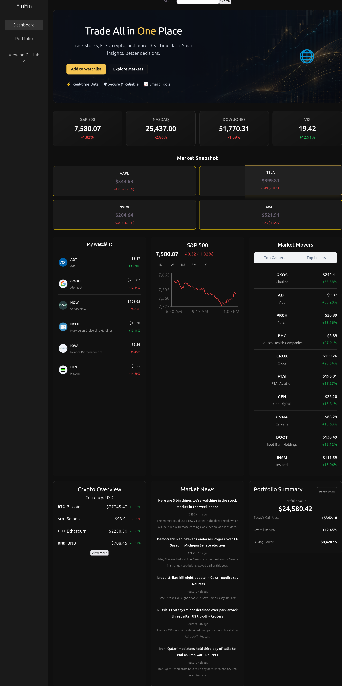
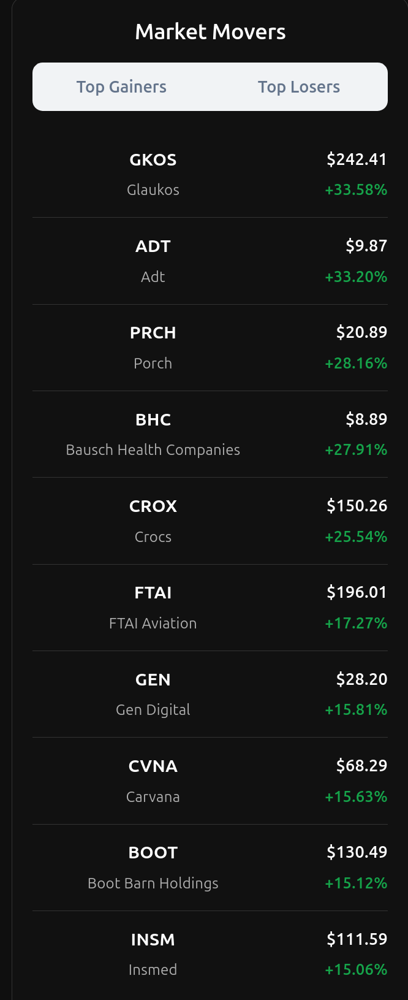

# Fintech Dashboard

A full-stack financial dashboard built with React, Vite, Node.js, and Express. Integrates external financial data sources to provide market insights, stock information, cryptocurrency data, and financial news through an interactive dashboard.

## Screenshots

### Full Dashboard


### S&P 500 Interactive Chart


### Market Movers and Watchlist


## Overview

The Fintech Dashboard combines a React frontend with a Node.js and Express backend to retrieve and display financial market information from external APIs.

This project demonstrates full-stack JavaScript development, REST API integration, asynchronous data retrieval, interactive data visualization, and environment-based API credential management.

## Features

### Market Overview
- Displays the S&P 500, NASDAQ Composite, Dow Jones Industrial Average, and VIX.
- Retrieves market information through backend API endpoints.
- Displays index values and percentage changes.

### Interactive Watchlist
- Displays selected stocks with company names, prices, and percentage changes.
- Retrieves company logos and financial information.

### S&P 500 Chart
- Interactive historical market chart built with Recharts.
- Multiple selectable time ranges: 1 day, 1 week, 1 month, 3 months, and 1 year.
- Formatted price and date tooltips.

### Market Movers
- Displays top-performing and declining stocks.
- Switches between top gainers and top losers.
- Displays stock prices and percentage changes.

### Cryptocurrency
- Displays cryptocurrency information and search results.

### Financial News
- Integrates external financial news data into the dashboard.

### Portfolio Summary
- Displays sample portfolio information using demonstration data.
- Does not connect to an actual brokerage account.

## Technology Stack

**Frontend**
- React
- Vite
- JavaScript (ES6+)
- CSS3
- Recharts

**Backend**
- Node.js
- Express
- REST APIs
- Fetch API
- Async/await
- CORS

**External Data Sources**
- Finnhub
- BusinessQuant
- Yahoo Finance News

## Project Architecture

The application uses a frontend/backend architecture:

- React and Vite handle the user interface and dashboard components.
- Node.js and Express handle backend routes and external API requests.
- External financial services provide market information.
- Environment variables keep API credentials separate from frontend source code.

## Installation and Setup

### Prerequisites
- Node.js
- npm
- Git

### 1. Clone the repository

```bash
git clone https://github.com/heintzmason2-sys/fintech-dashboard-react.git
cd fintech-dashboard-react
```

### 2. Install dependencies

```bash
npm install
```

### 3. Configure environment variables

Create a `.env.local` file in the project root.

Add your own API credentials using the variable names expected by the backend.

The `.env.local` file is excluded from version control through `.gitignore`.

**Never commit API keys or other credentials to GitHub.**

### 4. Start the backend

Open a terminal in the project directory:

```bash
npm run server
```

The Express backend starts on port `3000`.

### 5. Start the frontend

Open a second terminal in the project directory:

```bash
npm run dev
```

Vite provides a local development URL, typically:

```text
http://localhost:5173/
```

Open the address in your browser to use the dashboard.

## API Usage

The dashboard retrieves information from external financial data providers.

API availability and request limits depend on the providers' plans and usage policies. Some data may be subject to refresh limits.

## Future Improvements

- Expand cryptocurrency data coverage.
- Add additional financial data integrations.
- Expand portfolio analytics.
- Improve dashboard functionality and data visualization.
